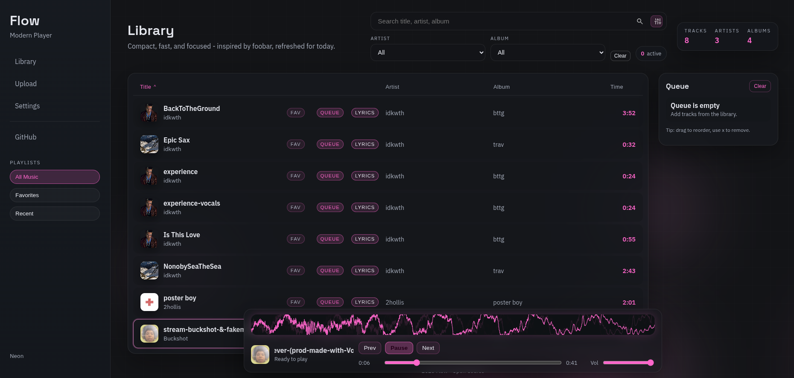

#  Flow

**Your music. Your library. Your flow.**

A lightweight, browser-based music player built with vanilla JavaScript, HTML, and CSS.

   

[**Launch Flow**](https://neonmc23.github.io/Flow/) · [Features](#-features) · [Getting Started](#-getting-started) · [Add Music](#-building-your-library)

---

## ◈ Preview

*Your library, your albums, your music — all in one place.*

---

## ◈ Overview

Flow is a compact, browser-based music player designed around your music library.

Explore albums, search your collection, manage playback, and enjoy real-time audio visualization — without frameworks or build tools.

